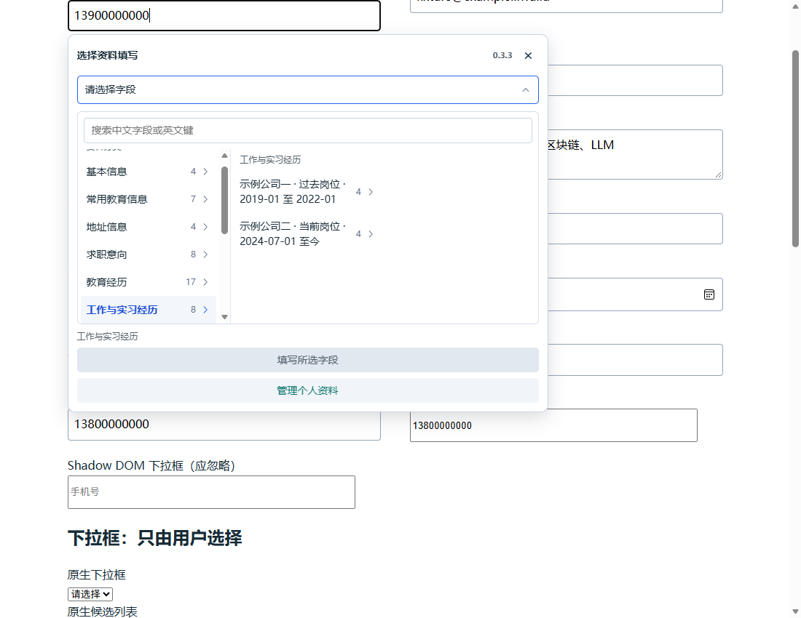
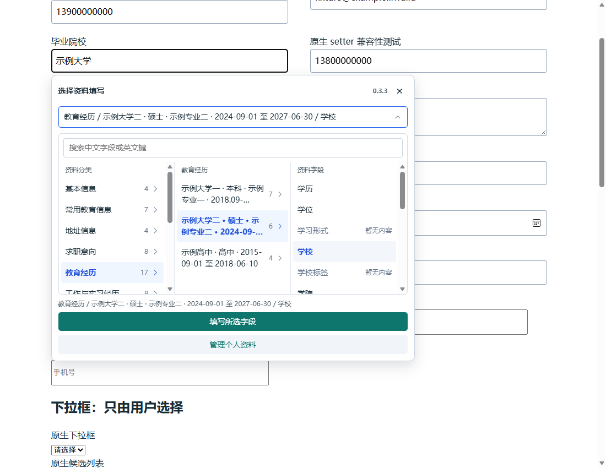

<div align="center">


# Smart Autofill

**校招投递很多次，个人资料维护一次。**

面向校招、实习与信息登记的本地浏览器扩展。点击输入框，选择已有资料，确认后填写。

[](https://github.com/6008-Git/Smart-Autofill/releases)
[](#快速开始)
[](smart-autofill/manifest.json)
[](https://github.com/6008-Git/Smart-Autofill/actions/workflows/ci.yml)
[](LICENSE)

[快速开始](#快速开始) · [使用体验](#使用体验) · [为什么逐项确认](#为什么逐项确认) · [隐私与边界](#隐私与边界) · [English](README.en.md)

</div>

## 为什么做这个工具

一轮校招，往往要在不同公司的招聘系统里反复填写同一份学校、实习和项目经历。字段顺序各不相同，还要区分本科与硕士、不同公司的职位和不同项目的介绍。

Smart Autofill 把重复录入变为选择已有资料：统一维护个人信息，按学校、公司和项目名称查找记录，将选中的内容写入当前输入框。更新资料后，后续投递继续复用。

**你负责选择目标和确认内容，插件负责查找与填写。**

## 使用体验



*真实扩展界面；所有截图均使用虚构资料。*

```text
维护或导入资料 → 点击输入框 / Alt+Z → 选择推荐或查找经历 → 确认填写当前字段
```

| 功能 | 带来的便利 |
| --- | --- |
| **一次维护，多站复用** | 姓名、联系方式、学校、实习和项目资料统一保存 |
| **按内容找到经历** | 展示学校、公司、职位、项目名称与时间摘要，支持中文和英文键搜索 |
| **推荐不准也能继续** | 在已支持的输入框中，可以手动选择任意已有资料字段 |
| **Alt+Z 手动唤起** | 光标在输入框内，点击未弹出时可用快捷键打开菜单 |
| **完整简历结构** | 140 项字段定义、13 个分类、7 类可增删记录 |
| **JSON 导入 / 导出** | 资料可备份、迁移；提供英文键与中文标签映射 |
| **本地运行** | 无账号、后端、远程模型调用或构建步骤 |
| **逐项确认** | 每次只填写当前字段；下拉框、提交操作留给用户 |

<details>
<summary>查看按学校和专业选择具体字段的界面</summary>



</details>

## 快速开始

**方式一：下载扩展包**

1. 从 [Releases](https://github.com/6008-Git/Smart-Autofill/releases/latest) 下载 `smart-autofill-版本号.zip`，解压。
2. Chrome 打开 `chrome://extensions/`；Edge 打开 `edge://extensions/`。
3. 开启开发者模式，选择「加载已解压的扩展程序」，选中解压后的 **`smart-autofill` 文件夹**。
4. 点击扩展图标 →「管理个人资料」，填写保存，或导入自己的 JSON。
5. 刷新招聘网页，点击需要填写的输入框。未弹出时保持光标在框内，按 **Alt+Z**。

**方式二：从源码加载**

```bash
git clone https://github.com/6008-Git/Smart-Autofill.git
```

在扩展管理页加载仓库内的 `smart-autofill/`，无需 `npm install` 或启动服务。

更新扩展后，先重新加载扩展，再刷新已打开的表单网页；以浮窗右上角版本号确认页面脚本已更新。已有资料无需重新导入。

## 为什么逐项确认

部分 LLM 一键填写方案会遇到表单识别失败、字段错配或遗漏。理解简历只是一个环节；工具还需要获得有效的页面信息、定位真实控件，并区分不同记录和表单步骤。

本插件由用户点击目标输入框，明确填写位置，再提供资料推荐。在已支持的输入框内，字段推荐不准确时，仍可从级联菜单手动选择内容。它减少了对整页自动识别与自动操作的依赖。

| 维度 | Smart Autofill | 基于 LLM 的自动填写方案 |
| --- | --- | --- |
| 目标定位 | 用户点击当前输入框 | 依赖工具提供的页面信息与定位策略 |
| 字段对应 | 规则推荐 + 用户手动选择 | 依具体方案进行语义识别、映射或生成 |
| 写入内容 | 复用已保存的字段值，不生成新内容 | 可复用资料，也可能生成或改写内容 |
| 推荐失败 | 支持手动查找已有字段 | 依具体方案提供重试、纠正或人工接管 |
| 使用依赖 | 无模型运行环境、API Key 或模型调用费用 | 可能需要本地模型或云端服务 |
| 自动化程度 | 当前字段确认填写，下拉框手动选择 | 部分方案支持更大范围的自动操作 |

LLM 适合开放式回答、岗位相关内容组织和复杂语义理解。本项目专注于已确定资料的快速复用；没有发布与其他产品的速度或准确率对比测评，也不承诺所有网站都兼容。

## 资料与备份

资料默认全部为空。可以从 [虚构示例 JSON](examples/profile.demo.json) 了解结构；示例会替换当前资料，只适合首次体验或独立测试配置。

```json
{
  "version": 2,
  "profile": {
    "basic": { "name": "示例同学", "email": "student@example.invalid" },
    "educationHistory": {
      "records": [{ "school": "示例大学", "major": "计算机科学", "dateRange": "2024.09-2027.06" }]
    }
  }
}
```

完整字段见 [英文 / 中文映射](doc/profile-field-mapping.json) 和 [资料使用说明](smart-autofill/README.md#json-导入导出)。`records` 保存多段经历；英文键采用 camelCase。

导入先预览，再确认替换全部资料；导出用于保存备份。常用教育字段未单独维护时，从同一条最近开始的教育经历读取；可编辑覆盖，不会把不同学校的资料混合补齐。

“信息表单”“网申”“某表单填……”等明确的来源标记会移入备注或数据来源，填写时只使用实际内容。备注、来源和待补充项保留在管理页，不作为填写候选；有冲突的单值字段需要确认。高中经历可单独维护，不推断学位或专业。

## 隐私与边界

- 资料保存在本地浏览器 `chrome.storage.local`，扩展不调用远程模型、不上传整份简历、不添加统计上报。
- 菜单按用户要求显示有限的记录摘要；网页可以看到已写入的值，招聘网站也按自身规则处理你填写或提交的信息。
- 权限声明仅 `storage`；内容脚本在授权的 HTTP/HTTPS 页面及匹配框架中运行。可以在浏览器扩展设置中调整站点访问范围。
- 支持 `input` 的 text、tel、email、number 类型及 textarea；已验证同源 HTTP/srcdoc iframe 和开放 Shadow DOM 中的原生输入框。
- **下拉框不触发插件**：select、datalist、声明为 combobox 或带选择语义的控件均由用户选择。
- 密码、只读、禁用、日期组件、contenteditable、封闭 Shadow DOM，以及浏览器禁止注入的页面不在当前支持范围。Alt+Z 无法绕过这些限制。
- 不整页自动填写，不自动登录、提交、翻页或处理验证码。网站格式校验和复杂组件仍需人工检查。

## 开发与验证

运行时：Manifest V3 + HTML/CSS + 原生 JavaScript，无第三方运行依赖。开发测试使用 Node.js 24；发布 ZIP 使用 Python 3 标准库。

```bash
node --test tests/core.test.mjs tests/profile-schema.test.mjs tests/field-tree.test.mjs tests/content-lifecycle.test.mjs
node scripts/verify-public.mjs
python scripts/package-extension.py
```

本地验收：**35 项单元测试通过，Chrome / Edge 各 48 项浏览器检查通过**。浏览器检查使用独立配置、虚构资料和 DevTools Protocol，没有引入 Playwright、Selenium 或应用后端。CI 运行单元测试、公开文件检查和扩展打包；浏览器检查按 [验收说明](doc/acceptance.md) 手动复现。

```text
smart-autofill/   可直接加载的扩展
examples/         虚构资料示例
doc/              字段映射、方案与验收记录
tests/            单元与浏览器检查
scripts/          图标、校验、打包与本地资料工具
```

## 参与项目

欢迎提交有明确复现步骤的 [兼容性问题](https://github.com/6008-Git/Smart-Autofill/issues/new/choose)、字段识别改进和文档贡献。反馈中请使用虚构信息，移除姓名、电话、证件号和招聘系统登录信息。

阅读 [贡献指南](CONTRIBUTING.md)、[安全说明](SECURITY.md) 和 [更新记录](CHANGELOG.md)。后续优先改善字段识别、输入框兼容性、可访问性与资料维护体验；复杂控件能力会先明确支持边界。

如果它帮你减少了校招中的重复录入，欢迎 Star 或分享给同学。也欢迎用真实反馈帮助项目变得更好。

## License

[MIT](LICENSE) © 2026 6008
